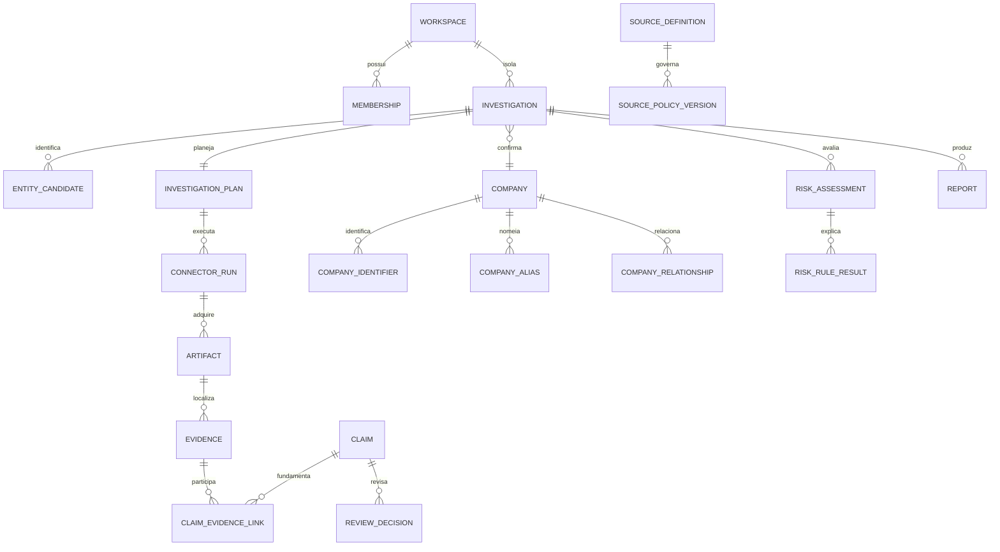

# Modelo de dados inicial

## 1. Princípios

- Modelo relacional normalizado para o núcleo; payload bruto somente em artefato/JSONB controlado.
- UUID gerado pela aplicação ou banco para IDs internos.
- `workspace_id` obrigatório em toda raiz agregada e em índices de acesso.
- Instantes em UTC com fuso; datas civis sem fuso apenas quando a fonte fornece somente data.
- Dinheiro em `NUMERIC`/`Decimal`, com moeda ISO 4217 e unidade explícita.
- País em ISO 3166-1 alfa-2; idioma em BCP 47.
- Registros derivados apontam para versão do método e entradas.
- Evidência e auditoria são append-only; correção, expiração e expurgo são eventos.

## 2. Visão de relações

## 3. Identidade e acesso

### `Workspace`

Fronteira lógica de autorização e retenção.

Campos mínimos: `id`, `name`, `status`, `retention_policy_version`, `created_at`, `updated_at`.

### `UserAccount`

Identidade interna do sistema, sem representar autenticação.

Campos da F2.4.1: `id`, `email`, `display_name`, `status`, `created_at`, `updated_at`. O e-mail é canônico em minúsculas, único e validado apenas por estrutura mínima local/domínio; não existe consulta DNS. Não há senha, credencial, sessão, token, login, sujeito OAuth ou MFA.

### `WorkspaceMembership`

Relaciona um usuário interno a um workspace.

Campos da F2.4.1: `id`, `workspace_id`, `user_id`, `role`, `status`, `created_at`, `updated_at`, `deactivated_at`.

Papéis persistidos: `OWNER`, `ADMIN`, `ANALYST`, `VIEWER`. Estados: `ACTIVE`, `INACTIVE`. A combinação `(workspace_id, user_id)` é permanentemente única; reativação futura reutiliza a mesma linha. Esta fase não implementa mudança de papel/estado, permissões ou proteção do último owner.

`UserAccount`, `WorkspaceMembership` e a persistência mínima de auditoria são materializados na F2.4.1. A existência de `requested_by`, de uma membership ou de um filtro `workspace_id` no repositório não prova autorização. Contexto do ator, matriz de permissões e isolamento nos serviços pertencem à F2.4.2.

## 4. Entidades empresariais

### `Company`

Campos implementados na F2.2: `id`, `workspace_id`, `legal_name`, `trade_name`, `country_code`, `legal_form`, `status`, `incorporated_on`, `dissolved_on`, `official_domain`, `created_at`, `updated_at`.

`jurisdiction_code` permanece no modelo alvo, mas não é criado na F2.2. Ele depende de um `JurisdictionCode` de domínio com semântica para registros nacionais, subnacionais e múltiplos registros por país. `country_code` não o substitui implicitamente.

`Company` é uma entidade canônica interna, não uma cópia de uma fonte. Cada atributo factual relevante deve ser apoiado por claim/evidência.

### `CompanyIdentifier`

Campos: `id`, `company_id`, `identifier_type`, `jurisdiction_code`, `value_original`, `value_normalized`, `valid_from`, `valid_until`, `claim_id`.

Constraint sugerida: unicidade de identificador normalizado por tipo/jurisdição quando o tipo é oficialmente único; exceções exigem política do pacote.

### `CompanyAlias`

Campos: `id`, `company_id`, `alias_type`, `name_original`, `name_normalized`, `language_tag`, `valid_from`, `valid_until`, `claim_id`.

### `Address`

Campos: `id`, `company_id`, `address_type`, linhas originais, componentes normalizados, `country_code`, geocódigo opcional, validade e `claim_id`.

### `CompanyRelationship`

Campos: `id`, `workspace_id`, `subject_company_id`, `object_entity_type`, `object_company_id` ou referência de pessoa autorizada, `relationship_type`, participação decimal opcional, período, `claim_id`.

Relações não confirmadas permanecem candidatas e não entram nesta tabela canônica.

## 5. Investigação

### `Investigation`

Substitui o conceito estreito de `SearchRun`.

Campos: `id`, `workspace_id`, `requested_by`, `profile_code`, `country_code`, `input_snapshot`, `state`, `state_version`, `confirmed_company_id`, `methodology_version_id`, `budget_amount`, `budget_currency`, `deadline_at`, `started_at`, `completed_at`, `created_at`.

`input_snapshot` é versionado e redigido; não deve virar depósito de segredos ou documentos.

Na F2.2/F2.2.1, somente os campos já representados pelo domínio são criados; `input_snapshot` e `methodology_version_id` permanecem adiados. Uma linha em `CREATED` exige `started_at` nulo; todo estado posterior exige início preenchido. Estados terminais exigem `completed_at`, e estados não terminais o proíbem. A investigação pode referenciar empresa canônica previamente cadastrada no mesmo workspace, e `deadline_at` não pode anteceder `created_at`. A presença inicial da empresa não altera por si só o estado nem implementa transição.

`requested_by` permanece UUID tipado sem foreign key também na F2.4.1. Bancos na revisão anterior podem conter investigações cujos UUIDs não correspondem a um `UserAccount`, e não existe backfill confiável. A migration não inventa identidades nem descarta ou altera investigações. A F2.4.2 validará ator e membership nos serviços; uma FK futura depende de reconciliação explícita dos dados existentes.

`budget_amount` usa `NUMERIC` sem precisão ou escala fixadas e rejeita `NaN` e infinitos, preservando o contrato de `Money` finito sem arredondamento ou conversão. Valores negativos continuam estruturalmente possíveis porque a F2.1 não definiu semântica de limite orçamentário; eventual proibição exige regra de negócio explícita.

Na F2.3, snapshots persistidos retornam ao domínio por `Investigation.reconstitute`. O contrato de criação continua aceitando somente `CREATED` e versão 1; a reconstituição aceita os estados canônicos já armazenados, preserva `state_version` e reaplica as invariantes de tipos, UTC, ordem e coerência entre estado e timestamps. Isso não implementa transição de estado.

### `InvestigationSubject`

Preserva os valores apresentados pelo usuário antes da confirmação: nomes, identificadores, domínio, endereço e idioma, com `input_kind` e valor original/normalizado.

### `EntityCandidate`

Campos: `id`, `investigation_id`, `candidate_key`, dados normalizados, origem, scores por dimensão, `policy_version`, `decision`, `decision_reason`, `decided_by`, `decided_at`.

Scores separados: identificador, nome, endereço, domínio, geografia, administradores e temporalidade. Não armazenar somente um score total opaco.

### `InvestigationPlan`

Campos: `id`, `investigation_id`, `version`, `country_pack_version`, `profile_version`, `created_at`, `created_by`, `budget_snapshot`, `deadline_at`.

### `PlannedCapability`

Campos: `plan_id`, `capability`, `required`, `connector_definition_id`, `reason`, `estimated_cost`, `status`.

### `ConnectorRun`

Campos: `id`, `workspace_id`, `investigation_id`, `planned_capability_id`, `connector_id`, `connector_version`, `source_policy_version_id`, `operation_id`, `attempt`, `state`, `started_at`, `finished_at`, `deadline_at`, `error_code`, `retriable`, `usage_snapshot`, `result_digest`.

Constraint: `operation_id + connector_id + operation_kind` único para efeito idempotente; tentativas são registros filhos ou contam separadamente sem duplicar resultado.

## 6. Fontes, artefatos e evidências

### `SourceDefinition`

Identidade estável da fonte, separada do código do conector.

Campos: `id`, `owner_name`, `display_name`, `country_scope`, `category`, `canonical_url`, `status`, `created_at`.

### `SourcePolicyVersion`

Snapshot aprovado: método de acesso, autenticação, licença, custo, limites, armazenamento, exibição, redistribuição, retenção, atualização, qualidade, aprovação jurídica/técnica/comercial e vigência.

### `ConnectorDefinition`

Campos: `id`, `source_id`, `connector_key`, `version`, `capabilities`, `country_codes`, `status`, `contract_version`, `credential_ref_name` sem segredo, `released_at`.

### `Artifact`

Container original adquirido ou enviado.

Campos: `id`, `workspace_id`, `investigation_id`, `connector_run_id` opcional, `origin_type`, `storage_mode`, `object_key` opcional, `content_type`, `byte_length`, `sha256`, `retrieval_url`, `retrieved_at`, `published_at`, `source_policy_version_id`, `encryption_key_ref`, `quarantine_status`, `retention_until`.

`storage_mode`: `OBJECT`, `EXCERPT_ONLY`, `REFERENCE_ONLY` ou `EPHEMERAL_PROCESSING`, sempre definido pela política.

### `Evidence`

Unidade localizável e imutável do contrato em `evidence-contract.md`.

Campos: `id`, `workspace_id`, `investigation_id`, `artifact_id`, `source_id`, `subject_ref`, `evidence_kind`, `original_language`, `locator_type`, `locator_value`, `content_original` quando permitido, `content_sha256`, `observed_at`, `published_at`, `valid_from`, `valid_until`, `extraction_method`, `extractor_version`, `entity_match_policy_version`, `admissibility_status`, `created_at`.

### `EvidenceDerivation`

Relaciona evidência derivada à(s) origem(ns): tradução, OCR, trecho, normalização ou cálculo. Campos: `derived_evidence_id`, `parent_evidence_id`, `derivation_type`, `method`, `version`, `parameters_digest`.

### `EvidenceLifecycleEvent`

Registra `ADMITTED`, `EXPIRED`, `REVOKED`, `REDACTED`, `PURGED_CONTENT` e motivo/autor. O conteúdo original não é sobrescrito.

## 7. Claims e fatos estruturados

### `Claim`

Campos: `id`, `workspace_id`, `investigation_id`, `subject_ref`, `predicate_code`, `value_type`, valor tipado, `valid_from`, `valid_until`, `criticality`, `status`, `extraction_confidence`, `created_by_type`, `method_version`, `created_at`.

Status: `PROPOSED`, `SUPPORTED`, `CONFLICTED`, `REJECTED`, `EXPIRED`, `SUPERSEDED`.

### `ClaimEvidenceLink`

Campos: `claim_id`, `evidence_id`, `role`, `relevance`, `link_reason`, `created_at`.

`role`: `SUPPORTS`, `CONTRADICTS`, `QUALIFIES`. Unicidade por claim/evidência/papel.

### `ReviewDecision`

Campos: `id`, `workspace_id`, `target_type`, `target_id`, `decision`, `reason_code`, `justification`, `reviewer_id`, `created_at`, `supersedes_decision_id`.

Decisões são append-only.

### Projeções factuais

`LegalEvent`, `FinancialMetric`, `ContactPoint`, `SanctionsMatch` e relações societárias são projeções tipadas de claims. Cada linha exige `claim_id`, período, valor original e atributos próprios. Não duplicar texto da evidência como verdade independente.

## 8. Risco e relatório

### `RiskMethodologyVersion`

Campos: `id`, `code`, `version`, `status`, `effective_from`, `effective_until`, `definition_digest`, `approved_by`, `approved_at`.

### `RiskRuleVersion`

Campos: metodologia, `rule_code`, categoria, condição declarativa, gravidade, impacto decimal, evidência mínima, revisão exigida e versão.

### `RiskAssessment`

Campos: `id`, `workspace_id`, `investigation_id`, metodologia, `input_snapshot_digest`, score decimal opcional, nível, qualidade de dados separada, status de revisão, `calculated_at`.

### `RiskRuleResult`

Campos: `assessment_id`, regra/versão, `outcome`, impacto, claim IDs usados, explicação determinística.

### `Report`

Campos: `id`, `workspace_id`, `investigation_id`, `version`, `cutoff_at`, `status`, `template_version`, `content_digest`, `artifact_id`, `approved_by`, `approved_at`, `created_at`.

Status: `DRAFT`, `IN_REVIEW`, `APPROVED`, `EXPORTED`, `SUPERSEDED`.

## 9. Auditoria

### `AuditEvent`

Campos da F2.4.1: `id`, `workspace_id`, `actor_user_id`, `action_code`, `resource_type`, `resource_id`, `outcome`, `reason_code`, `correlation_id`, `occurred_at`.

Resultados: `SUCCESS`, `DENIED`, `FAILURE`. Recursos iniciais: `WORKSPACE`, `USER`, `MEMBERSHIP`, `COMPANY`, `INVESTIGATION`. `resource_id` é uma referência polimórfica tipada no domínio e não possui foreign key. Não há payload ou JSON genérico.

Não registrar tokens, payload bruto, conteúdo de documento ou dado pessoal desnecessário.

A materialização mínima de `AuditEvent` pertence à F2.4.1. O evento é imutável, e a porta possui somente `add`; correções futuras criam outro evento. Foreign keys de workspace e ator usam `RESTRICT`, sem cascata, para que eventos sobrevivam à desativação. A coordenação com autorização e a emissão automática por casos de uso pertencem à F2.4.2; repositórios não geram auditoria por efeito colateral.

## 10. Índices e constraints iniciais

- todos os acessos por raiz: índice começando por `workspace_id`;
- `Investigation(workspace_id, state)` para consultas de raiz na F2.2; ordenação temporal será avaliada quando `updated_at` ou eventos persistidos forem introduzidos;
- `ConnectorRun(operation_id, connector_id, operation_kind)` único;
- `Artifact(workspace_id, sha256, source_policy_version_id)` para deduplicação permitida;
- `Evidence(investigation_id, subject_ref, admissibility_status)`;
- `Claim(investigation_id, subject_ref, predicate_code, status)`;
- `AuditEvent(workspace_id, occurred_at)` particionável por volume;
- checks para país, moeda, scores no intervalo definido e período válido;
- foreign keys sem cascade destrutivo sobre evidência, claim, avaliação e auditoria.

Na F2.2, `Company(id, workspace_id)` possui chave unique técnica e `Investigation(confirmed_company_id, workspace_id)` usa foreign key composta. Assim, uma empresa confirmada nunca pertence a workspace diferente do agregado, inclusive em escrita SQL direta. Essa chave é redundante em relação à PK de empresa, mas torna o isolamento verificável no banco. Row Level Security permanece adiado e não foi substituído por essa constraint.

Consultas de `Company`, `Investigation` e `WorkspaceMembership` incluem `workspace_id`; `Workspace` é consultado apenas por seu próprio ID porque ele é a raiz da fronteira. Esses filtros são defesa em profundidade e não substituem contexto do ator, autorização de caso de uso ou emissão coordenada de auditoria, reservados à F2.4.2.

## 11. Retenção e exclusão

Expurgo de conteúdo usa job autorizado, política versionada e evento de auditoria. Metadados mínimos e hashes podem permanecer somente quando permitido. “Direito ao apagamento” e obrigações contratuais precisam ser reconciliados por política; não existe delete genérico de investigação em código de domínio.

## 12. Questões de schema ainda abertas

- modelo de pessoas e beneficiários versus referências externas minimizadas;
- necessidade de isolamento físico além de `workspace_id`;
- particionamento de evidência/auditoria;
- política exata de criptografia por workspace;
- formas de busca de nomes/endereços e extensões PostgreSQL;
- retenção de email/telefone nominativo.
