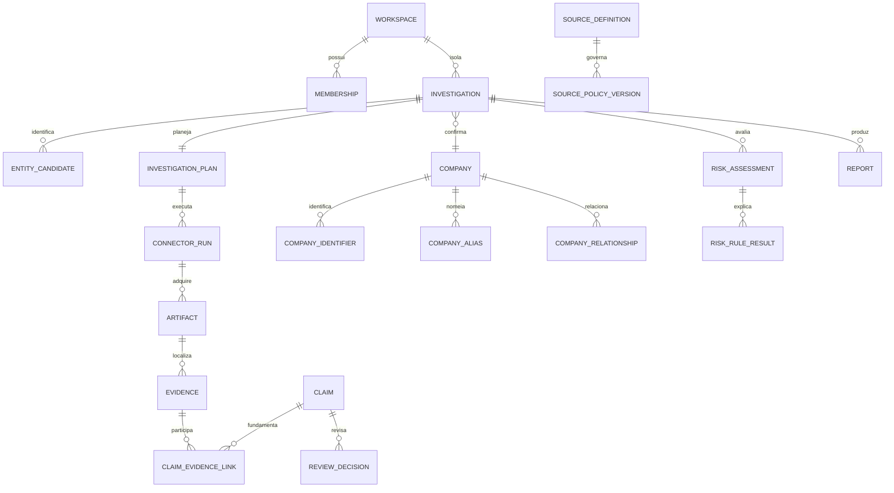

# Modelo de dados inicial

## 1. Princípios

- Modelo relacional normalizado para o núcleo; payload bruto somente em artefato/JSONB controlado.
- UUID gerado pela aplicação ou banco para IDs internos.
- `workspace_id` obrigatório em toda raiz agregada e em índices de acesso.
- Instantes em UTC com fuso; datas civis sem fuso apenas quando a fonte fornece somente data.
- Dinheiro em `NUMERIC`/`Decimal`, com moeda ISO 4217 e unidade explícita.
- País em ISO 3166-1 alfa-2; idioma em BCP 47.
- Registros derivados apontam para versão do método e entradas.
- Evidência e auditoria são append-only; correção, expiração e expurgo são eventos.

## 2. Visão de relações

## 3. Identidade e acesso

### `Workspace`

Fronteira lógica de autorização e retenção.

Campos mínimos: `id`, `name`, `status`, `retention_policy_version`, `created_at`, `updated_at`.

### `UserAccount`

Identidade interna do sistema, sem representar autenticação.

Campos da F2.4.1: `id`, `email`, `display_name`, `status`, `created_at`, `updated_at`. O e-mail é canônico em minúsculas, único e validado apenas por estrutura mínima local/domínio; não existe consulta DNS. Não há senha, credencial, sessão, token, login, sujeito OAuth ou MFA.

### `WorkspaceMembership`

Relaciona um usuário interno a um workspace.

Campos da F2.4.1: `id`, `workspace_id`, `user_id`, `role`, `status`, `created_at`, `updated_at`, `deactivated_at`.

Papéis persistidos: `OWNER`, `ADMIN`, `ANALYST`, `VIEWER`. Estados: `ACTIVE`, `INACTIVE`. A combinação `(workspace_id, user_id)` é permanentemente única; reativação reutiliza a mesma linha. Na F2.4.2, `change_role`, `deactivate` e `reactivate` produzem snapshots imutáveis, preservam identidade/tenant e rejeitam regressão temporal. O serviço protege o último owner sob locks PostgreSQL; o repositório apenas persiste o snapshot autorizado.

`UserAccount`, `WorkspaceMembership` e a persistência mínima de auditoria são materializados na F2.4.1. A F2.4.2 adiciona autorização no serviço: usuário e membership precisam existir, estar ativos e pertencer ao workspace do `ActorContext`; o papel precisa possuir permissão explícita. Filtros de repositório continuam sendo defesa em profundidade, não autorização autônoma.

## 4. Entidades empresariais

### `Company`

Campos implementados na F2.2: `id`, `workspace_id`, `legal_name`, `trade_name`, `country_code`, `legal_form`, `status`, `incorporated_on`, `dissolved_on`, `official_domain`, `created_at`, `updated_at`.

`jurisdiction_code` permanece no modelo alvo, mas não é criado na F2.2. Ele depende de um `JurisdictionCode` de domínio com semântica para registros nacionais, subnacionais e múltiplos registros por país. `country_code` não o substitui implicitamente.

`Company` é uma entidade canônica interna e uma âncora de identidade, não uma cópia de uma fonte nem prova de seus próprios atributos. Sua materialização após confirmação humana não torna os dados reportáveis; cada atributo factual relevante deve ser apoiado posteriormente por claim/evidência admissível.

### `CompanyIdentifier`

Campos: `id`, `company_id`, `identifier_type`, `jurisdiction_code`, `value_original`, `value_normalized`, `valid_from`, `valid_until`, `claim_id`.

Constraint sugerida: unicidade de identificador normalizado por tipo/jurisdição quando o tipo é oficialmente único; exceções exigem política do pacote.

### `CompanyAlias`

Campos: `id`, `company_id`, `alias_type`, `name_original`, `name_normalized`, `language_tag`, `valid_from`, `valid_until`, `claim_id`.

### `Address`

Campos: `id`, `company_id`, `address_type`, linhas originais, componentes normalizados, `country_code`, geocódigo opcional, validade e `claim_id`.

### `CompanyRelationship`

Campos: `id`, `workspace_id`, `subject_company_id`, `object_entity_type`, `object_company_id` ou referência de pessoa autorizada, `relationship_type`, participação decimal opcional, período, `claim_id`.

Relações não confirmadas permanecem candidatas e não entram nesta tabela canônica.

## 5. Investigação

### `Investigation`

Substitui o conceito estreito de `SearchRun`.

Campos: `id`, `workspace_id`, `requested_by`, `profile_code`, `country_code`, `input_snapshot`, `state`, `state_version`, `confirmed_company_id`, `methodology_version_id`, `budget_amount`, `budget_currency`, `deadline_at`, `started_at`, `completed_at`, `created_at`.

`input_snapshot` é versionado e redigido; não deve virar depósito de segredos ou documentos. A F4.1 materializou o envelope fechado `IdentificationInput` schema `1`; a F4.2 preserva compatibilidade e admite o schema `2` opt-in para administradores e data de constituição. Ambos usam JSONB fechado, `input_schema_version` e digest SHA-256 canônico.

Na F2.2/F2.2.1, `input_snapshot` e `methodology_version_id` foram adiados. A F4.1 materializa somente o snapshot de entrada; `methodology_version_id` continua ausente. Uma linha em `CREATED` exige entrada e `started_at` nulos; todo estado posterior exige início preenchido. Estados terminais exigem `completed_at`, e estados não terminais o proíbem. Estados iniciados novos exigem entrada. A F4.3 proíbe Company antes da confirmação e a exige entre `PLANNING` e os estados de conclusão; FAILED/CANCELLED podem tê-la conforme o momento. Constraints `NOT VALID` preservam linhas históricas sem fabricar conteúdo, mas protegem novas escritas. `deadline_at` não pode anteceder `created_at`.

`requested_by` permanece UUID tipado sem foreign key. Bancos na revisão anterior podem conter investigações cujos UUIDs não correspondem a um `UserAccount`, e não existe backfill confiável. A F2.4.2 valida novas criações no serviço e define `requested_by = actor.user_id` depois de autorizar usuário e membership. Uma FK futura ainda depende de reconciliação explícita dos dados existentes.

`budget_amount` usa `NUMERIC` sem precisão ou escala fixadas e rejeita `NaN` e infinitos, preservando o contrato de `Money` finito sem arredondamento ou conversão. Valores negativos continuam estruturalmente possíveis porque a F2.1 não definiu semântica de limite orçamentário; eventual proibição exige regra de negócio explícita.

Na F2.3, snapshots persistidos retornam ao domínio por `Investigation.reconstitute`. O contrato de criação continua aceitando somente `CREATED` e versão 1. Na F4.1–F4.5, a reconstituição também valida entrada, lote ativo e coerência da Company confirmada. `start_identification`, `request_entity_confirmation`, `confirm_entity`, `start_collection` e `cancel` são transições específicas e imutáveis. A criação de plano F4.4 não é transição; a ativação F4.5 incrementa uma vez e entra em `COLLECTING`.

### `InvestigationTransition`

Ledger append-only materializado na F4.1. Campos: `id`, `workspace_id`,
`investigation_id`, `command_id`, `command_type`, `state_before`,
`version_before`, `state_after`, `version_after`, `actor_user_id`, `reason_code`,
`occurred_at`, `command_digest`, `correlation_id` e, para F4.2,
`candidate_batch_id`, `candidate_count`, `top_classification`, `policy_id` e
`policy_version`. A F4.3 acrescenta IDs de decisão, Company, lote e candidato,
motivo, classificação/rank e IDs/versões das políticas de matching e
materialização. A F4.5 acrescenta run, quantidade de operações e ID/versão da
política de ativação. A F4.5.1 acrescenta à mesma transição os IDs da Company e
do plano, permitindo validar o vínculo histórico exato contra o run.

`command_type` aceita `START_IDENTIFICATION`, `CANCEL_INVESTIGATION`,
`REQUEST_ENTITY_CONFIRMATION`, `CONFIRM_ENTITY_CANDIDATE` e `START_COLLECTION`. A versão posterior é exatamente a anterior + 1.
`(workspace_id, command_id)` é único e a FK composta
`(investigation_id, workspace_id)` impede vínculo cross-tenant. O repositório
não expõe update/delete.

### `InvestigationSubject`

Preserva os valores apresentados pelo usuário antes da confirmação: nomes, identificadores, domínio, endereço e idioma, com `input_kind` e valor original/normalizado.

### `EntityCandidate`

Materializado na F4.2 como três tabelas. `entity_candidate_batch` contém escopo,
comando/autor, versão, digests e snapshot integral da política.
`entity_candidate` contém chave, identidade/origem fechadas, rank, total,
cobertura, classificação, conflito, digest e decisão obrigatoriamente
`PENDING_REVIEW`. `entity_candidate_dimension_score` contém dimensão, score,
peso, contribuição, disponibilidade, conflito e explicação.

Scores separados: identificador, nome, domínio, geografia, endereço,
administradores e temporalidade. FKs compostas incluem workspace; lote é único
por investigação/comando e não há update/delete. Candidatos não são evidência,
claim ou empresa. `active_candidate_batch_id` aponta o lote da pausa; a
constraint de linhas novas é `NOT VALID` apenas para preservar histórico sem
fabricar dados.

A F4.2.1 não altera essas tabelas. Na reconstituição, o cabeçalho fornece
política e input digest obrigatórios para cada candidato; identidade, origem,
dimensões e avaliações são reconstruídas em seus contratos oficiais. Pesos,
total, cobertura, classificação, conflitos, digests e ranking precisam
corresponder exatamente. A serialização canônica do lote ordena candidatos por
`candidate_key`, pois ordem de submissão não é coluna nem semântica do matching.
O mapper falha fechado com erro redigido e nunca corrige a linha adulterada.

### `EntityResolutionDecision`

Materializado na F4.3 em tabela append-only. Liga workspace, investigação,
comando, lote, candidato, nova Company e revisor; persiste motivo fechado,
rank/classificação, digests da avaliação, snapshot/digest da política de
materialização e digests da Company/decisão. FKs compostas protegem escopo e
unicidades impõem uma decisão por investigação, comando e Company no workspace.
O repositório reconstitui decisão, Company, Investigation, lote e candidato e
recalcula os digests; qualquer divergência falha fechado. Não há update/delete.
O candidato permanece `PENDING_REVIEW`.

### `InvestigationPlan`, `PlannedCapability` e `PlannedConnectorOption`

Materializados na F4.4 em três tabelas append-only. `investigation_plan` liga
workspace, Investigation e Company confirmada; preserva perfil, país, orçamento,
deadline, versão/status, política canônica, digests de entrada/Company/plano,
comando, ator e instante. Há um plano por Investigation e um comando por
workspace. Os campos `command_id` e `command_digest` formam o registro durável
do comando de planejamento, separado do ledger de transições porque não há
mudança de lifecycle.

`planned_capability` mantém capacidade, requisito, prioridade, motivo fechado,
dependências tipadas, custo/prazo e status. `planned_connector_option` mantém a
cópia imutável do descritor relevante, operações, rank de elegibilidade e
estimativas. FKs compostas propagam workspace/Investigation por todo o agregado;
unicidades impedem capacidades, ranks e conectores duplicados. O repositório
reconstitui política, grafo, custos e todos os digests, falhando fechado diante
de ausência ou adulteração. Não há update/delete público.

A F4.4.1 mantém o agregado histórico legível quando a Investigation atual
avança por estados pós-confirmação autorizados e conserva Company, ausência de
lote ativo e versão monotônica. As três chaves de leitura compartilham essa
validação. A migration `20260801_07` reforça na auditoria que comando e custo
estejam todos ausentes ou formem um conjunto `UNKNOWN`/`KNOWN` completo.

### `CollectionRun`, `CollectionOperation` e dependências

Materializados na F4.5 em três tabelas append-only. `collection_run` liga
workspace, Investigation, Company e plano; registra versões, status `PENDING`,
política canônica/digest, digests do plano/Company/comando/run, orçamento,
deadline, custo agregado, ator e instante. Há um run por Investigation e plano.

`collection_operation` copia a capacidade e a opção rank 1 persistida, incluindo
conector, versões, fonte, operações declaradas, cobertura, acesso, custo,
duração, status `PENDING`, tentativa zero e digest. A tabela de dependências usa
FKs compostas para limitar ambas as pontas ao mesmo run e conserva ordem
canônica. Reconstituição recalcula digests e confronta o manifesto com o plano;
não há update/delete público. Esses registros não são jobs, resultados,
evidências ou claims.

A migration `20260802_09` reforça a FK da transição para o conjunto run,
workspace, Investigation, Company e plano. Na leitura por comando,
Investigation, plano ou ID, run sem transição e transição F4.5 sem run são dados
inválidos, nunca ausência comum.

### Ownership e conclusões operacionais da F4.6

`collection_operation_execution` registra ownership único por operação e
workspace antes do I/O. Conserva comando/digest, escopo completo, ator,
descritor, versão da source policy, locales, snapshot/digest da política de
execução, instante e digest do ownership. FK composta impede apontar para operação
de outro run/tenant.

`collection_operation_execution_result` é filho 1:1 do ownership e armazena somente
status/códigos, accounting agregado, fingerprint/digest do runner, estado de
idempotência/controle, instante e digest. Não possui itens, payload, observações
ou artefatos. As portas são append-only, a leitura revalida os digests e o
downgrade recusa apagar histórico. Esses registros não são `ConnectorRun`, job,
evidência, claim factual, risco ou relatório.

`Ownership` é vocabulário operacional e não pertence ao agregado factual
`Claim`; nenhum consumidor de evidência, risco ou relatório pode tratá-lo como
afirmação sobre a empresa.

### `ConnectorRun`

Campos: `id`, `workspace_id`, `investigation_id`, `planned_capability_id`, `connector_id`, `connector_version`, `source_policy_version_id`, `operation_id`, `attempt`, `state`, `started_at`, `finished_at`, `deadline_at`, `error_code`, `retriable`, `usage_snapshot`, `result_digest`.

Constraint: `operation_id + connector_id + operation_kind` único para efeito idempotente; tentativas são registros filhos ou contam separadamente sem duplicar resultado.

## 6. Fontes, artefatos e evidências

### `SourceDefinition`

Identidade estável da fonte, separada do código do conector.

Campos: `id`, `owner_name`, `display_name`, `country_scope`, `category`, `canonical_url`, `status`, `created_at`.

### `SourcePolicyVersion`

Snapshot aprovado: método de acesso, autenticação, licença, custo, limites, armazenamento, exibição, redistribuição, retenção, atualização, qualidade, aprovação jurídica/técnica/comercial e vigência.

### `ConnectorDefinition`

Campos: `id`, `source_id`, `connector_key`, `version`, `capabilities`, `country_codes`, `status`, `contract_version`, `credential_ref_name` sem segredo, `released_at`.

### `Artifact`

Container original adquirido ou enviado.

Materializado na F5.1 como `evidence_artifact`: `id`, workspace, Investigation,
`source_id` e `source_policy_version` em snapshot, origem e fingerprint, método e
versão de aquisição, ator, consulta, publicação ou ausência explícita, tipo de
mídia, SHA-256/tamanho dos bytes originais, storage/retenção/exibição/sensibilidade,
instante, versão de schema e digest. Bytes integrais são transitórios e não são
coluna. `connector_run_id`, catálogo por FK, encryption key, quarentena e adapter
de objetos continuam adiados.

`storage_mode`: `OBJECT`, `EXCERPT_ONLY`, `REFERENCE_ONLY` ou `EPHEMERAL_PROCESSING`, sempre definido pela política.

### `Evidence`

Unidade localizável e imutável do contrato em `evidence-contract.md`.

Materializada na F5.1 como série versionada: `id`, `series_id`, versão e
`supersedes_evidence_id`; workspace, Investigation, Company, decisão humana e
artefato; comando/digest; tipo, idioma, locator tipado canônico, hash e trecho
quando permitido; método/versão de extração; política/versão de matching; ator,
instante, schema e digest. Toda linha F5.1 permanece `PENDING`. FKs compostas
impedem trocar tenant, Investigation, Company, decisão, artefato, raiz da série,
versão supersedida ou evidência relacionada. Locks transacionais distintos para
idempotência e versão-alvo serializam correção/revogação concorrentes.

### `EvidenceDerivation`

Relaciona evidência derivada à(s) origem(ns): tradução, OCR, trecho, normalização ou cálculo. Campos: `derived_evidence_id`, `parent_evidence_id`, `derivation_type`, `method`, `version`, `parameters_digest`.

### `EvidenceLifecycleEvent`

Na F5.1 registra somente `SUPERSEDED` por `CORRECTION` e `REVOKED` com motivo
fechado, ator, comando/digest, instante, versão de schema e digest. A correção
aponta a nova evidência e a revogação é terminal. `ADMITTED`, `EXPIRED`,
`REDACTED` e `PURGED_CONTENT` continuam futuros; o conteúdo não é sobrescrito.

## 7. Claims e fatos estruturados

### `Claim`

Campos: `id`, `workspace_id`, `investigation_id`, `subject_ref`, `predicate_code`, `value_type`, valor tipado, `valid_from`, `valid_until`, `criticality`, `status`, `extraction_confidence`, `created_by_type`, `method_version`, `created_at`.

Status: `PROPOSED`, `SUPPORTED`, `CONFLICTED`, `REJECTED`, `EXPIRED`, `SUPERSEDED`.

### `ClaimEvidenceLink`

Campos: `claim_id`, `evidence_id`, `role`, `relevance`, `link_reason`, `created_at`.

`role`: `SUPPORTS`, `CONTRADICTS`, `QUALIFIES`. Unicidade por claim/evidência/papel.

### `ReviewDecision`

Campos: `id`, `workspace_id`, `target_type`, `target_id`, `decision`, `reason_code`, `justification`, `reviewer_id`, `created_at`, `supersedes_decision_id`.

Decisões são append-only.

### Projeções factuais

`LegalEvent`, `FinancialMetric`, `ContactPoint`, `SanctionsMatch` e relações societárias são projeções tipadas de claims. Cada linha exige `claim_id`, período, valor original e atributos próprios. Não duplicar texto da evidência como verdade independente.

## 8. Risco e relatório

### `RiskMethodologyVersion`

Campos: `id`, `code`, `version`, `status`, `effective_from`, `effective_until`, `definition_digest`, `approved_by`, `approved_at`.

### `RiskRuleVersion`

Campos: metodologia, `rule_code`, categoria, condição declarativa, gravidade, impacto decimal, evidência mínima, revisão exigida e versão.

### `RiskAssessment`

Campos: `id`, `workspace_id`, `investigation_id`, metodologia, `input_snapshot_digest`, score decimal opcional, nível, qualidade de dados separada, status de revisão, `calculated_at`.

### `RiskRuleResult`

Campos: `assessment_id`, regra/versão, `outcome`, impacto, claim IDs usados, explicação determinística.

### `Report`

Campos: `id`, `workspace_id`, `investigation_id`, `version`, `cutoff_at`, `status`, `template_version`, `content_digest`, `artifact_id`, `approved_by`, `approved_at`, `created_at`.

Status: `DRAFT`, `IN_REVIEW`, `APPROVED`, `EXPORTED`, `SUPERSEDED`.

## 9. Auditoria

### `AuditEvent`

Campos da F2.4.1: `id`, `workspace_id`, `actor_user_id`, `action_code`, `resource_type`, `resource_id`, `outcome`, `reason_code`, `correlation_id`, `occurred_at`.

Resultados: `SUCCESS`, `DENIED`, `FAILURE`. Recursos iniciais: `WORKSPACE`, `USER`, `MEMBERSHIP`, `COMPANY`, `INVESTIGATION`. `resource_id` é uma referência polimórfica tipada no domínio e não possui foreign key. Não há payload ou JSON genérico.

Não registrar tokens, payload bruto, conteúdo de documento ou dado pessoal desnecessário.

A materialização mínima de `AuditEvent` pertence à F2.4.1. Na F2.4.2, helpers explícitos criam eventos somente a partir do contexto confiável e de catálogos fechados. Sucesso de mutação é append na mesma transação; negação é commitada sem mutação antes do erro; falha conhecida usa `FAILURE` quando a transação permite. O repositório continua somente com `add`, sem efeito colateral oculto.

## 10. Índices e constraints iniciais

- todos os acessos por raiz: índice começando por `workspace_id`;
- `Investigation(workspace_id, state)` para consultas de raiz;
- `InvestigationTransition(workspace_id, investigation_id, version_after)` e `(workspace_id, occurred_at)` para histórico e auditoria operacional;
- `ConnectorRun(operation_id, connector_id, operation_kind)` único;
- `evidence_artifact(workspace_id, investigation_id)` para custódia tenant-first;
- `evidence(workspace_id, series_id)` e unicidade de versão/comando;
- `evidence_lifecycle_event(workspace_id, investigation_id)` e comando único;
- `Claim(investigation_id, subject_ref, predicate_code, status)`;
- `AuditEvent(workspace_id, occurred_at)` particionável por volume;
- checks para país, moeda, scores no intervalo definido e período válido;
- foreign keys sem cascade destrutivo sobre evidência, claim, avaliação e auditoria.

Na F2.2, `Company(id, workspace_id)` possui chave unique técnica e `Investigation(confirmed_company_id, workspace_id)` usa foreign key composta. Assim, uma empresa confirmada nunca pertence a workspace diferente do agregado, inclusive em escrita SQL direta. Essa chave é redundante em relação à PK de empresa, mas torna o isolamento verificável no banco. Row Level Security permanece adiado e não foi substituído por essa constraint.

Consultas de `Company`, `Investigation` e `WorkspaceMembership` incluem `workspace_id`; `Workspace` é consultado apenas por seu próprio ID porque ele é a raiz da fronteira. Os serviços da F2.4.2 obtêm esse valor somente de `ActorContext`, autorizam antes de acessar recursos e retornam ausência segura para outro workspace. Os filtros relacionais permanecem defesa em profundidade.

## 11. Retenção e exclusão

Expurgo de conteúdo usa job autorizado, política versionada e evento de auditoria. Metadados mínimos e hashes podem permanecer somente quando permitido. “Direito ao apagamento” e obrigações contratuais precisam ser reconciliados por política; não existe delete genérico de investigação em código de domínio.

## 12. Questões de schema ainda abertas

- modelo de pessoas e beneficiários versus referências externas minimizadas;
- necessidade de isolamento físico além de `workspace_id`;
- particionamento de evidência/auditoria;
- política exata de criptografia por workspace;
- formas de busca de nomes/endereços e extensões PostgreSQL;
- retenção de email/telefone nominativo.
