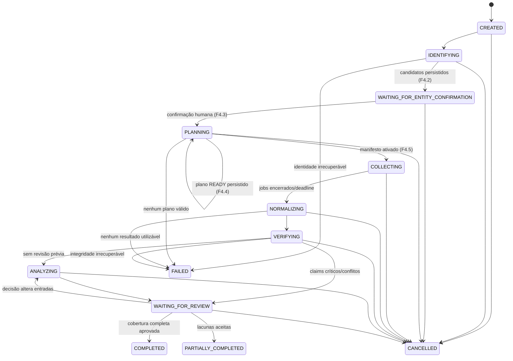

# Ciclo de vida da investigação

## 1. Princípios

- Estado é persistido no agregado `Investigation` e alterado por comandos válidos.
- Toda transição materializada gera resultado tipado, ledger durável e auditoria com ator, motivo e versão.
- Workers não alteram estado diretamente; publicam resultado para o orquestrador.
- Transições usam optimistic locking por `state_version`.
- Repetir o mesmo comando com o mesmo `command_id` tenant-scoped e digest é idempotente.
- `NO_RESULTS` de uma fonte é resultado válido, não falha técnica.

## 2. Estados canônicos

| Estado | Significado | Invariante de entrada |
|---|---|---|
| `CREATED` | solicitação validada e persistida | workspace/ator/perfil presentes |
| `IDENTIFYING` | geração e avaliação de candidatos | ao menos nome ou identificador utilizável |
| `WAITING_FOR_ENTITY_CONFIRMATION` | decisão humana necessária | candidatos e motivos disponíveis |
| `PLANNING` | criação do plano versionado | entidade confirmada |
| `COLLECTING` | jobs de conectores/documentos ativos | plano congelado e jobs idempotentes |
| `NORMALIZING` | resultados viram observações neutras | todos os jobs encerrados ou deadline atingido |
| `VERIFYING` | resolução final, evidência e claims | observações processáveis registradas |
| `ANALYZING` | risco preliminar e relatório rascunho | claims elegíveis calculados |
| `WAITING_FOR_REVIEW` | revisão humana pendente | fila de revisão e limitações materializadas |
| `COMPLETED` | resultado completo aprovado | critérios completos atendidos |
| `PARTIALLY_COMPLETED` | resultado útil aprovado com lacunas | aceite explícito das lacunas |
| `FAILED` | investigação sem resultado utilizável | motivo terminal registrado |
| `CANCELLED` | cancelada por ator/política | pedido e efeitos tardios controlados |

Estados terminais: `COMPLETED`, `PARTIALLY_COMPLETED`, `FAILED`, `CANCELLED`.

### 2.1 Timestamps persistidos

- `started_at` é nulo somente em `CREATED` e passa a existir na transição `CREATED -> IDENTIFYING`;
- todo estado diferente de `CREATED` exige `started_at`;
- `completed_at` é o instante de entrada em um estado terminal, inclusive `FAILED` ou `CANCELLED`;
- estados terminais exigem `completed_at`, enquanto estados não terminais o proíbem;
- `completed_at` nunca antecede `started_at`.

No cancelamento direto `CREATED -> CANCELLED`, a investigação não entra em identificação. O ciclo inicia e termina atomicamente no instante do cancelamento, registrado com `started_at = completed_at`. Isso preserva a coerência do snapshot sem afirmar que coleta ou análise começaram.

Essas invariantes descrevem snapshots persistidos. Na F4.1–F4.5, somente os
comandos específicos de início, pausa, confirmação e cancelamento podem
alterá-los; não existe setter ou API de estado destino arbitrário.

### 2.2 Criação e reconstituição

Uma nova investigação continua sendo construída somente em `CREATED`, com `state_version = 1` e sem timestamps de início/término. A F2.3 introduz `Investigation.reconstitute(...)` para ler snapshots que já foram persistidos em outros estados. O método revalida o vocabulário, a versão positiva, os tipos e todas as regras temporais desta seção, sem executar uma transição e sem produzir evento.

Somente o mapper de persistência usa o contrato de reconstituição. A criação é exclusivamente em `CREATED`, sem Company confirmada: o workspace vem do `ActorContext`, `requested_by` é exatamente `actor.user_id` e o evento `INVESTIGATION_CREATED` compartilha a transação. A F4.1 adicionou início/cancelamento, a F4.2 a pausa, a F4.3 a confirmação, a F4.4 um plano separado e a F4.5 a ativação explícita. Nenhuma execução de conector foi adicionada.

### 2.3 Entrada de identificação F4.1

`IdentificationInput` schema `1` é imutável e fechado. O schema `2` opt-in da
F4.2 acrescenta administradores e data de constituição sem mudar o schema 1. Ele preserva nomes e
valores de identificadores originais separadamente dos normalizados, tipa
identificador, jurisdição, domínio e endereço e valida coerência com o país da
investigação. Sem `confirmed_company_id`, exige ao menos um sinal utilizável.

O snapshot usa JSON canônico em `input_snapshot`, acompanhado por
`input_schema_version` e `input_digest`. `CREATED` não possui entrada. Ao entrar
em `IDENTIFYING`, o snapshot fica congelado; reconstituição recalcula forma e
digest. A representação pública é redigida e auditoria nunca recebe o conteúdo.

## 3. Fluxo



## 4. Transições e comandos

### 4.1 Materializados na F4.1

- `StartIdentification`: `CREATED -> IDENTIFYING`.
- `CancelInvestigation`: qualquer não terminal `-> CANCELLED`.

Ambos exigem `command_id` forte, versão esperada e ator autorizado. O serviço
usa CAS por `(workspace_id, investigation_id, state_version)`, registra a
transição no ledger append-only e inclui a auditoria no mesmo commit. Replay de
digest idêntico devolve o registro existente sem novo incremento ou auditoria;
digest diferente sob o mesmo ID gera colisão. `OWNER`, `ADMIN` e `ANALYST` são
permitidos; `VIEWER` é negado.

### 4.2 Materializado na F4.2

- `RequestEntityConfirmation`: `IDENTIFYING -> WAITING_FOR_ENTITY_CONFIRMATION`.

Exige lote explícito com digest da entrada, política versionada, CAS e ator
autorizado. Lote, candidatos, dimensões, transição e auditoria compartilham um
commit. Replay idêntico não recalcula matching, não lê relógio e não cria lote.
Nenhum candidato é confirmado e a política serve apenas para ranking/revisão.

A F4.2.1 torna o digest canônico do lote independente da ordem incidental de
submissão, ordenando sua representação por `candidate_key`. Como o matching já
é independente dessa ordem, permutações do mesmo conjunto também compartilham o
command digest. Na leitura, avaliações e ranking são integralmente reconstruídos
antes de o lote ser devolvido.

### 4.3 Materializado na F4.3

- `ConfirmEntityCandidate`: `WAITING_FOR_ENTITY_CONFIRMATION -> PLANNING`.

O candidato é escolhido explicitamente por humano, nunca pelo score. `EXCLUDED`
é bloqueado; LOW ou rank maior que 1 exige `MANUAL_OVERRIDE`. A transação cria
uma nova Company pela política V1, registra decisão append-only, preenche a
Company da investigação, limpa o lote ativo, aplica CAS e inclui ledger e
auditoria. Replay valida todos os registros sem relógio ou IDs novos. Entrar em
`PLANNING` não cria plano.

A correção F4.3.1 explicita que a transição acima é o fato histórico da
confirmação. A Investigation atual pode estar em `PLANNING`, `COLLECTING`,
`NORMALIZING`, `VERIFYING`, `ANALYZING`, `WAITING_FOR_REVIEW`, `COMPLETED`,
`PARTIALLY_COMPLETED`, `FAILED` ou `CANCELLED`. Ela deve preservar a mesma
Company, manter o lote ativo nulo e ter versão maior ou igual à versão da
transição; igualdade exige `PLANNING`. Replay nunca restaura o estado histórico.

### 4.4 Materializado na F4.4, sem transição

- `CreateInvestigationPlan`: cria plano `READY` e mantém `PLANNING` com a mesma
  `state_version`.

O comando exige versão esperada e Company confirmada. OWNER, ADMIN e ANALYST são
permitidos; VIEWER é negado. Lock de comando, replay/collision, lock da
Investigation, plano completo e auditoria usam uma transação. A linha de plano
serve também como registro durável do comando. Não há registro no ledger de
transições porque nenhum lifecycle transition ocorreu.

A F4.4.1 preserva esse plano quando o snapshot atual avança para `PLANNING`,
`COLLECTING`, `NORMALIZING`, `VERIFYING`, `ANALYZING`, `WAITING_FOR_REVIEW`,
`COMPLETED`, `PARTIALLY_COMPLETED`, `FAILED` ou `CANCELLED`. A versão não pode
regredir; igualdade com a versão de criação exige `PLANNING`. Company diferente,
lote ativo reintroduzido e estados anteriores falham fechados. A leitura não
executa transição nem restaura o estado histórico.

### 4.5 Materializado na F4.5

- `StartInvestigationCollection`: `PLANNING -> COLLECTING`.

Exige Company confirmada, lote ativo nulo, plano `READY` íntegro e pertencente
ao mesmo tenant/contexto. O serviço cria run/operações a partir do rank 1
persistido, aplica CAS, registra ledger/auditoria e faz um único commit. Replay
íntegro não lê clock, gera IDs, aplica CAS nem escreve. O manifesto não executa
conector e não é job ou resultado.

Correção F4.5.1: antes da transição, o prazo restante é comparado com o caminho
crítico das operações de capacidades `READY`; igualdade é aceita. O ledger deve
coincidir exatamente com o run em comando/digest, versões, ator, instante, ID,
Company, plano, política e quantidade. Persistência parcial falha fechado.

### 4.6 Execução direta sem transição, implementada e aguardando revisão

`ExecuteCollectionSearchOperation` não altera o lifecycle. Ele consome uma
operação do manifesto enquanto a Investigation continua em `COLLECTING`, cria
ownership pré-I/O e conclusão redigida e preserva run/operação em `PENDING`. Não há
evento no ledger de transições. Este corte executa somente um `SEARCH` em `TEST`.

### 4.7 Planejados, não implementados nem autorizados após a F4.6

- `RejectAllCandidates`: retorna a identificação com nova entrada quando permitido ou termina `FAILED` com motivo.
- `CloseCollection`: `COLLECTING -> NORMALIZING` após todos os jobs em estado final ou deadline.
- `NormalizeResults`: `NORMALIZING -> VERIFYING` se houver material processável; caso contrário `FAILED`.
- `VerifyClaims`: segue para `WAITING_FOR_REVIEW` se houver item obrigatório; senão `ANALYZING`.
- `CalculateAssessment`: `ANALYZING -> WAITING_FOR_REVIEW`.
- `ApplyReviewDecision`: pode permanecer em espera ou voltar a `ANALYZING` quando muda entradas.
- `CompleteInvestigation`: espera `-> COMPLETED` ou `PARTIALLY_COMPLETED` conforme cobertura.

Transição inválida retorna erro de domínio e não produz evento parcial.

## 5. Estado futuro de jobs

Jobs ainda não existem no lifecycle persistido e não são criados pela F4.1. O
modelo abaixo permanece alvo documental para fase posterior autorizada.

`ConnectorRun` usa estado independente:

```text
PENDING -> RUNNING -> SUCCEEDED | NO_RESULTS | PARTIAL |
                     FAILED_TRANSIENT | FAILED_PERMANENT |
                     POLICY_BLOCKED | TIMED_OUT | CANCELLED
```

`FAILED_TRANSIENT` pode gerar nova tentativa enquanto deadline, budget e limite permitirem. A tentativa anterior permanece auditável. O agregado considera o resultado final da operação, não somente a última exceção.

## 6. Regras objetivas de término

### `COMPLETED`

Todos os itens são verdadeiros:

1. entidade confirmada;
2. toda capacidade `required` do perfil terminou em `SUCCEEDED` ou `NO_RESULTS` válido;
3. nenhuma falha required está sem resolução;
4. claims críticos e conflitos foram revisados;
5. avaliação determinística calculada ou explicitamente não aplicável;
6. relatório aprovado e limitações incluídas;
7. auditoria de conclusão persistida.

### `PARTIALLY_COMPLETED`

Todos os itens são verdadeiros:

1. entidade confirmada e existe resultado útil/evidência admissível;
2. ao menos uma capacidade required terminou com falha, bloqueio ou timeout;
3. lacunas aparecem no relatório;
4. pessoa com alçada aceitou a conclusão parcial;
5. claims críticos restantes não são apresentados como fatos;
6. relatório foi aprovado como parcial.

### `FAILED`

Ocorre quando nenhuma identidade pode ser confirmada, nenhum material utilizável é obtido para o perfil mínimo, há falha interna irrecuperável que invalida integridade ou política impede toda execução. Relatório factual não é exportado.

### `CANCELLED`

Na F4.1, o cancelamento registra ator/motivo fechado e impede reabertura. Não há
jobs persistidos para cancelar nem resultado tardio para propagar. Propagação a
jobs/conectores e retenção de artefatos pertencem a fase posterior.

## 7. Retomada e reexecução

- Reiniciar worker não muda estado.
- Reprocessamento usa as mesmas entradas/versões ou cria nova versão explícita.
- Reinvestigação após conclusão cria nova `Investigation` relacionada; não reabre história final.
- Correção administrativa exige evento compensatório, nunca edição silenciosa.

## 8. Timeouts e progresso

Progresso é calculado por capacidades e jobs, não por tempo estimado arbitrário. Deadline encerra novas tentativas, fecha coleta e permite parcial/falha. Interface mostra capacidade, estado, última atualização e erro público seguro.

## 9. Testes mínimos

- toda transição válida e inválida;
- concorrência com `state_version` desatualizada;
- repetição idempotente de comandos;
- cancelamento com resultado tardio;
- `NO_RESULTS` versus falha;
- required/optional e cálculo de parcial;
- falha de outbox/worker e retomada;
- retorno à análise após revisão;
- terminal não reabre.
