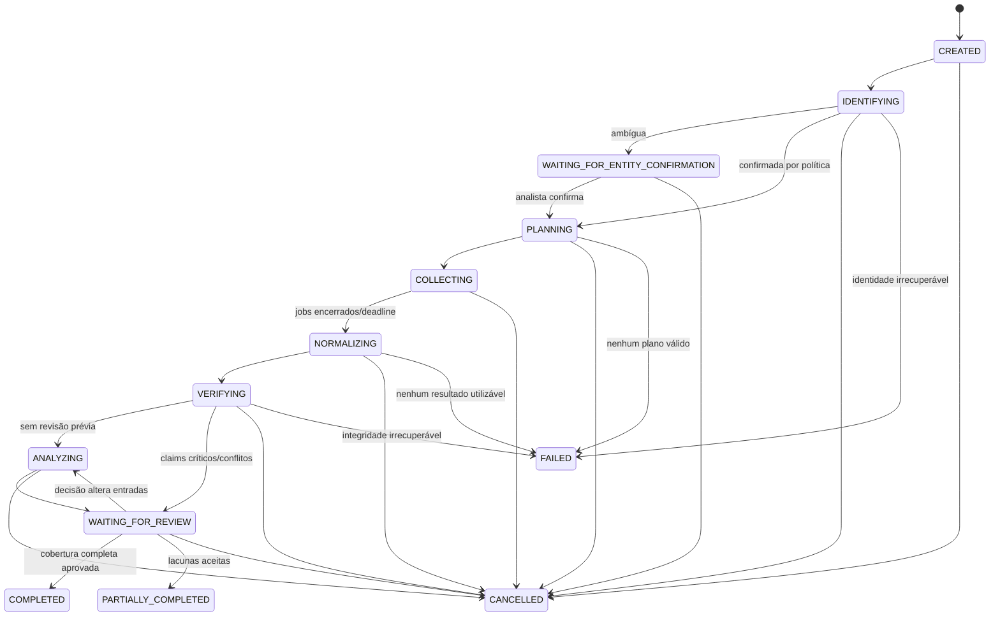

# Ciclo de vida da investigação

## 1. Princípios

- Estado é persistido no agregado `Investigation` e alterado por comandos válidos.
- Toda transição gera evento de domínio e auditoria com ator, motivo e versão.
- Workers não alteram estado diretamente; publicam resultado para o orquestrador.
- Transições usam optimistic locking por `state_version`.
- Repetir o mesmo comando com a mesma chave é idempotente.
- `NO_RESULTS` de uma fonte é resultado válido, não falha técnica.

## 2. Estados canônicos

| Estado | Significado | Invariante de entrada |
|---|---|---|
| `CREATED` | solicitação validada e persistida | workspace/ator/perfil presentes |
| `IDENTIFYING` | geração e avaliação de candidatos | ao menos nome ou identificador utilizável |
| `WAITING_FOR_ENTITY_CONFIRMATION` | decisão humana necessária | candidatos e motivos disponíveis |
| `PLANNING` | criação do plano versionado | entidade confirmada |
| `COLLECTING` | jobs de conectores/documentos ativos | plano congelado e jobs idempotentes |
| `NORMALIZING` | resultados viram observações neutras | todos os jobs encerrados ou deadline atingido |
| `VERIFYING` | resolução final, evidência e claims | observações processáveis registradas |
| `ANALYZING` | risco preliminar e relatório rascunho | claims elegíveis calculados |
| `WAITING_FOR_REVIEW` | revisão humana pendente | fila de revisão e limitações materializadas |
| `COMPLETED` | resultado completo aprovado | critérios completos atendidos |
| `PARTIALLY_COMPLETED` | resultado útil aprovado com lacunas | aceite explícito das lacunas |
| `FAILED` | investigação sem resultado utilizável | motivo terminal registrado |
| `CANCELLED` | cancelada por ator/política | pedido e efeitos tardios controlados |

Estados terminais: `COMPLETED`, `PARTIALLY_COMPLETED`, `FAILED`, `CANCELLED`.

### 2.1 Timestamps persistidos

- `started_at` é nulo somente em `CREATED` e passa a existir na transição `CREATED -> IDENTIFYING`;
- todo estado diferente de `CREATED` exige `started_at`;
- `completed_at` é o instante de entrada em um estado terminal, inclusive `FAILED` ou `CANCELLED`;
- estados terminais exigem `completed_at`, enquanto estados não terminais o proíbem;
- `completed_at` nunca antecede `started_at`.

No cancelamento direto `CREATED -> CANCELLED`, a investigação não entra em identificação. O ciclo inicia e termina atomicamente no instante do cancelamento, registrado com `started_at = completed_at`. Isso preserva a coerência do snapshot sem afirmar que coleta ou análise começaram.

Essas invariantes descrevem snapshots persistidos. Elas não autorizam alteração direta de estado nem substituem os futuros comandos transacionais e eventos de auditoria.

### 2.2 Criação e reconstituição

Uma nova investigação continua sendo construída somente em `CREATED`, com `state_version = 1` e sem timestamps de início/término. A F2.3 introduz `Investigation.reconstitute(...)` para ler snapshots que já foram persistidos em outros estados. O método revalida o vocabulário, a versão positiva, os tipos e todas as regras temporais desta seção, sem executar uma transição e sem produzir evento.

Somente o mapper de persistência usa esse contrato no round-trip atual. Transições, optimistic locking, autorização do ator e auditoria continuam fora da F2.3; isolamento de serviços, memberships e auditoria mínima formam a F2.4 separada.

## 3. Fluxo



## 4. Transições e comandos

- `StartIdentification`: `CREATED -> IDENTIFYING`.
- `RequestEntityConfirmation`: `IDENTIFYING -> WAITING_FOR_ENTITY_CONFIRMATION`.
- `ConfirmEntity`: espera/identificação `-> PLANNING`; registra política ou revisor.
- `RejectAllCandidates`: retorna a identificação com nova entrada quando permitido ou termina `FAILED` com motivo.
- `CreatePlan`: `PLANNING -> COLLECTING` somente após persistir plano e outbox na mesma transação.
- `CloseCollection`: `COLLECTING -> NORMALIZING` após todos os jobs em estado final ou deadline.
- `NormalizeResults`: `NORMALIZING -> VERIFYING` se houver material processável; caso contrário `FAILED`.
- `VerifyClaims`: segue para `WAITING_FOR_REVIEW` se houver item obrigatório; senão `ANALYZING`.
- `CalculateAssessment`: `ANALYZING -> WAITING_FOR_REVIEW`.
- `ApplyReviewDecision`: pode permanecer em espera ou voltar a `ANALYZING` quando muda entradas.
- `CompleteInvestigation`: espera `-> COMPLETED` ou `PARTIALLY_COMPLETED` conforme cobertura.
- `CancelInvestigation`: qualquer não terminal `-> CANCELLED`; publica cancelamentos e ignora efeitos tardios.

Transição inválida retorna erro de domínio e não produz evento parcial.

## 5. Estado de jobs

`ConnectorRun` usa estado independente:

```text
PENDING -> RUNNING -> SUCCEEDED | NO_RESULTS | PARTIAL |
                     FAILED_TRANSIENT | FAILED_PERMANENT |
                     POLICY_BLOCKED | TIMED_OUT | CANCELLED
```

`FAILED_TRANSIENT` pode gerar nova tentativa enquanto deadline, budget e limite permitirem. A tentativa anterior permanece auditável. O agregado considera o resultado final da operação, não somente a última exceção.

## 6. Regras objetivas de término

### `COMPLETED`

Todos os itens são verdadeiros:

1. entidade confirmada;
2. toda capacidade `required` do perfil terminou em `SUCCEEDED` ou `NO_RESULTS` válido;
3. nenhuma falha required está sem resolução;
4. claims críticos e conflitos foram revisados;
5. avaliação determinística calculada ou explicitamente não aplicável;
6. relatório aprovado e limitações incluídas;
7. auditoria de conclusão persistida.

### `PARTIALLY_COMPLETED`

Todos os itens são verdadeiros:

1. entidade confirmada e existe resultado útil/evidência admissível;
2. ao menos uma capacidade required terminou com falha, bloqueio ou timeout;
3. lacunas aparecem no relatório;
4. pessoa com alçada aceitou a conclusão parcial;
5. claims críticos restantes não são apresentados como fatos;
6. relatório foi aprovado como parcial.

### `FAILED`

Ocorre quando nenhuma identidade pode ser confirmada, nenhum material utilizável é obtido para o perfil mínimo, há falha interna irrecuperável que invalida integridade ou política impede toda execução. Relatório factual não é exportado.

### `CANCELLED`

O cancelamento registra ator/motivo, solicita cancelamento de jobs e impede que resultados tardios reabram a investigação. Artefatos já adquiridos seguem política de retenção.

## 7. Retomada e reexecução

- Reiniciar worker não muda estado.
- Reprocessamento usa as mesmas entradas/versões ou cria nova versão explícita.
- Reinvestigação após conclusão cria nova `Investigation` relacionada; não reabre história final.
- Correção administrativa exige evento compensatório, nunca edição silenciosa.

## 8. Timeouts e progresso

Progresso é calculado por capacidades e jobs, não por tempo estimado arbitrário. Deadline encerra novas tentativas, fecha coleta e permite parcial/falha. Interface mostra capacidade, estado, última atualização e erro público seguro.

## 9. Testes mínimos

- toda transição válida e inválida;
- concorrência com `state_version` desatualizada;
- repetição idempotente de comandos;
- cancelamento com resultado tardio;
- `NO_RESULTS` versus falha;
- required/optional e cálculo de parcial;
- falha de outbox/worker e retomada;
- retorno à análise após revisão;
- terminal não reabre.
